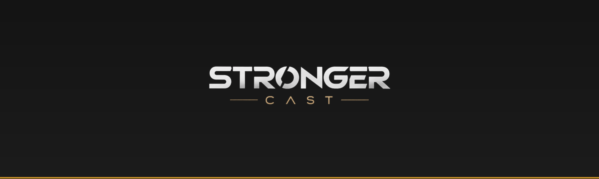

<p align="center">
  
</p>

<h1 align="center">Stronger Cast</h1>

<p align="center">
  <b>Força, fé e expectativa pra essa geração.</b><br/>
  Site oficial do podcast — quem somos, episódios e links pra ouvir.
</p>

<p align="center">
  <a href="https://vytor0-ifpi.github.io/strongercast/"></a>
  
  
</p>

<p align="center">
  <a href="https://vytor0-ifpi.github.io/strongercast/">🌐 Ver site</a> ·
  <a href="#-episódios">🎬 Episódios</a> ·
  <a href="#-rodar-local">💻 Rodar local</a>
</p>

---

## 📖 Sobre

O **Stronger Cast** é um podcast nascido pra essa geração: conversas honestas sobre
fé, decisões, relacionamentos e futuro — sem papo furado. O intuito é simples:
**reforçar quem anda cansado.**

Este repositório é o **site oficial**. É uma página única, leve e estática, que
apresenta o podcast e deixa qualquer pessoa **assistir e ouvir os episódios aqui mesmo**
(embutidos), com botões de saída pro **YouTube** e **Spotify**.

## ✨ O que tem no site

- **Quem somos** — o propósito do projeto em linguagem direta.
- **Episódios** — cada EP vira um bloco com vídeo assistível **no próprio site**
  e botões **YouTube** / **Spotify**.
- **Rodapé social** — Instagram, YouTube, Spotify e contato.
- **Responsivo** — lindo no celular, tablet e desktop.
- **Sem servidor, sem custo** — HTML/CSS/JS puro, publicado no GitHub Pages.

## 🎬 Episódios

| EP | Título | Convidado | Situação |
|----|--------|-----------|----------|
| 01 | Como ser um jovem forte nessa geração? | Pastora Vanessa | **Estreia22/10/2026** — vídeo em breve |


## ➕ Adicionar um episódio

Tudo acontece em **um arquivo só**: [`episodios.js`](episodios.js).

1. Abra `episodios.js`.
2. **Copie** um bloco `{ ... }` inteiro (o mais recente fica **primeiro** na lista).
3. **Edite**: `num`, `titulo`, `convidado`, `data`.
4. **Links**: cole o ID do vídeo (o trecho depois de `v=` no link do YouTube) e o
   ID do episódio no Spotify (depois de `episode/`). Enquanto estiverem vazios
   (`""`), o site mostra "em breve".
5. **Salve e faça push** — o site atualiza sozinho em ~1 minuto.

## 🚀 Publicar (deploy)

O deploy é **automático**. Toda vez que algo é enviado pra branch `main`, o
**GitHub Pages** reconstrói e republica o site. Não tem etapa manual.

```bash
git add .
git commit -m "feat: adiciona EP02"
git push origin main
```

## 💻 Rodar local

Pra ver o site na sua máquina antes de publicar:

```bash
cd 09-site
python3 -m http.server 8080
# abra http://localhost:8080
```

## 🗂 Estrutura

```
strongercast/
├── index.html        # página única (quem somos + episódios)
├── style.css         # visual — identidade preto & ouro
├── app.js            # renderiza episódios e links
├── episodios.js      # ⭐ dados dos episódios (edite só aqui)
├── README.md
└── assets/
    ├── logo.png          # logo oficial (fundo transparente)
    └── banner-readme.png # banner do README
```

## 🛠 Tecnologias

- **HTML5 · CSS3 · JavaScript** (vanilla — sem frameworks, sem build)
- **Noto Sans** (tipografia, igual à identidade visual)
- Publicado em **GitHub Pages**

## 📄 Licença

MIT © Stronger Cast — livre pra estudar, copiar e adaptar. A identidade visual e
as marcas do podcast são de propriedade do projeto.
